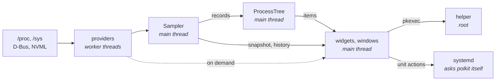
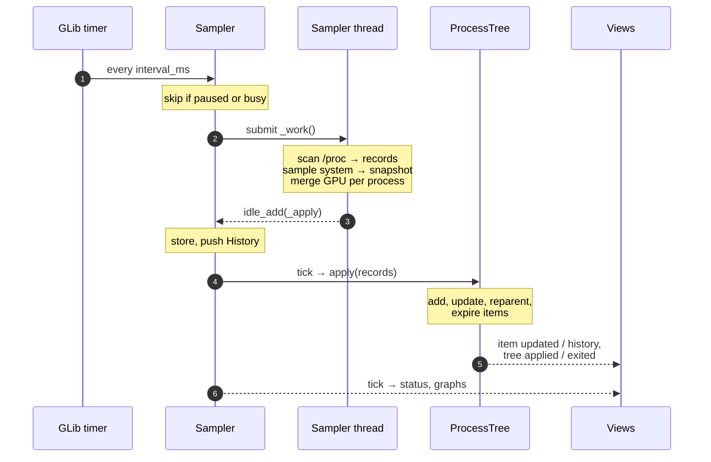
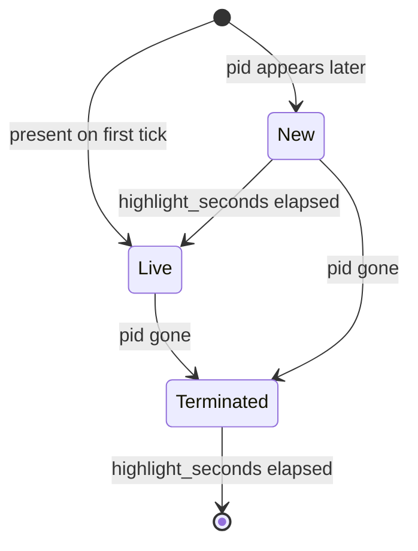
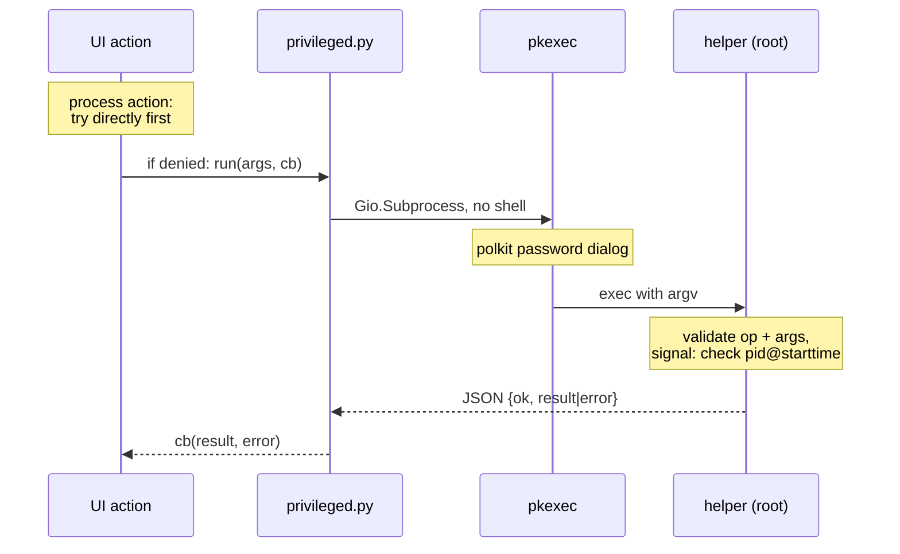
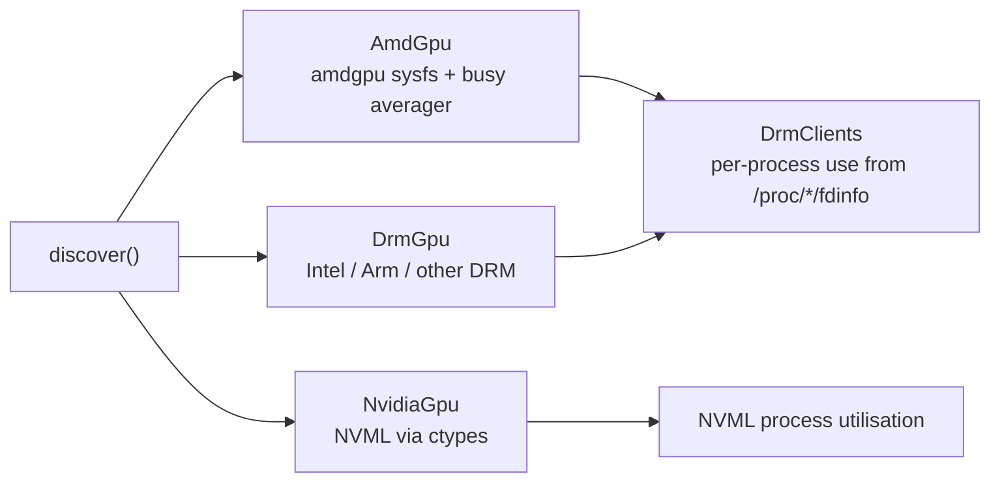

# Architecture

Procular is a single-process GTK 4 / libadwaita application written in Python. It reads what it
shows from `/proc` and `/sys` (directly, and through `psutil` for the system-wide counters), from
systemd over D-Bus and from NVML for NVIDIA GPUs. It runs no daemon, and it runs as the user who
started it. An operation that needs root is either one call of a short-lived helper process
started with `pkexec` or, for systemd units, a D-Bus call that systemd authorises itself.

This document explains how the pieces fit together. For features, installation and the test
commands, see [README.md](README.md).

## Overview

The diagram shows three boundaries:

- **Threads.** Providers do their periodic and slow work in worker threads and return plain
  data. Only the main thread touches widgets and models (see
  [Threading model](#threading-model)).
- **Two data paths.** On every tick, the sampler passes the process records to the tree, which
  turns them into `ProcessItem`s, and passes the system snapshot and history to the views
  directly. Everything else is loaded on demand: the unit and socket lists and the pages of a
  Properties window with `run_async`, and unit properties, the journal and host names with GLib's
  own async calls.
- **Privilege.** The app needs no root rights and never elevates itself. An action that the user
  may not perform, typically on another user's process, is one `pkexec` call into the helper. An
  action on a systemd unit is authorised by systemd (see
  [Privilege elevation](#privilege-elevation)).

`Config` is not drawn. Components read it where they need a setting, and those that must follow
a change react to its `changed` signal.

| Package | Responsibility | GTK? |
|---|---|---|
| [app.py](procular/app.py), [config.py](procular/config.py) | The application object (shared state, actions, CSS) and the settings. | yes / GObject |
| [providers/](procular/providers/) | Collect raw data. Return plain dicts and lists. | GLib/GObject only (`Sampler`, D-Bus) |
| [models/](procular/models/) | Turn sample dicts into long-lived GObjects that list models can bind to. | GObject |
| [widgets/](procular/widgets/) | Reusable views and the six main tabs. | yes |
| [windows/](procular/windows/) | Top-level windows and dialogs. | yes |
| [util/](procular/util/) | `/proc` parsers ([linux.py](procular/util/linux.py)), formatting, icons, threading, elevation, teardown, audio. | mostly no |
| [helper/](procular/helper/) | The privileged helper. Standard library only. | no |

Imports point one way. Windows use widgets, both use models, providers and `util`, and providers
and models use `util`. `util` and `helper` import nothing from the other packages. The app also
imports a few functions from the helper for unprivileged use (`signal_if_same`, `read_starttime`,
`set_oom_score_adj` and the per-thread setters). A widget never imports a window: it is handed the window object
(`win`) instead.

Providers and `util/linux.py` contain no widget code, so they can be unit tested without a
display. A large part of [tests/](tests/) targets them.

## Startup

[`__main__.py`](procular/__main__.py) checks the GTK (≥ 4.12) and libadwaita (≥ 1.5) versions and
then runs [`ProcularApp`](procular/app.py). The application is single-instance: starting it again
presents the window of the running one. Only the headless test runs start an instance of their
own. `do_startup` builds the shared state that all windows use:

- `app.config`: the [`Config`](procular/config.py) object
- `app.sampler`: the [`Sampler`](procular/providers/sampler.py)
- `app.tree`: the [`ProcessTree`](procular/models/process_tree.py), connected to the sampler's
  `tick` here, before any window exists
- `app.services`, `app.icons` and `app.user_colors`
- the application actions and their accelerators
- two CSS providers: the static [style.css](procular/style.css) and a generated one for row highlights

`do_activate` creates the `MainWindow` and starts the sampler.
`do_shutdown` saves the window state and the config.

The main window, System Information, Preferences and About receive the app object and read their
state from it. A Properties window receives the main window and reaches the sampler, tree and
config through it. Secondary windows are imported when they are first opened. No module-level
singleton holds application state: there are only small caches (user, group and tty names), a
few shared icons, the `run_async` thread pool and the set of running audio players.

## The sampling loop

Everything that changes once per refresh interval comes from one `tick` signal.

How the loop behaves:

- **One worker, no overlap.** The sampler has a single-thread executor and a `_busy` flag. If a
  scan takes longer than the interval, the next timer callback is skipped rather than queued. If
  the worker raises, the traceback is printed and that tick is dropped. The timer keeps running.
- **The worker never touches GTK.** It only produces plain dicts. Results return to the main
  loop through `GLib.idle_add`, and only there are GObjects changed and signals emitted.
- **Handed-over data is read-only.** Both threads hold the same record dicts: the scanner hands
  out an idle process's dict again on the next scan, while the main thread still reads it
  (`item.rec`, `sampler.records`). So a record is never changed once it has left the worker. Code
  that has to add something replaces the record with a copy, as `merge_process_usage` does for
  the GPU figures. In the other direction, the main thread steers the worker only through plain
  attributes (`scanner.want_fds`, `gpu.watched`, `system.detailed`), and those are replaced as a
  whole too.
- **Scans are cheap and incremental.** [`ProcessScanner`](procular/providers/processes.py) reads
  `/proc` itself, because `psutil` is slower for a full scan. It keeps each process's
  `stat`/`statm`/`io` file descriptors open, if the open-file limit can be raised far enough, and
  re-reads them with `pread`. When the raw bytes are unchanged, it hands out the previous record
  dict again. It reads the expensive `status` file, and `exe`/`cmdline`/`cgroup`, for new and
  young processes (under 5 s), when the command name changed, and otherwise on a staggered
  refresh every 30 scans. The tree in turn skips the rows whose record did not change.
- **Collect only what is shown.** `ProcessView` sets `scanner.want_fds` / `want_status` /
  `want_oom` and `gpu.want_processes` according to the visible columns. The scanner flags are not
  free: with `want_status` (Swap, Context switches) the `status` file is read on every scan, with
  `want_oom` (OOM score, OOM adjustment) two more small files, with `want_fds` (Open files) every
  process's descriptors are counted, and with any of them no record is reused. `SystemInfoWindow` calls
  `system.set_detailed(True)` (sensors, per-disk and per-NIC details) only while it is open. A
  Properties window calls `gpu.watch(pid)` for per-process GPU figures.
- **The tree comes first.** Handlers of `tick` run in the order they were connected, and the
  tree's was connected in `do_startup`. A view's own `tick` handler therefore finds `tree.items`
  already up to date.
- **Pause and refresh.** `app.pause` (F6) stops the timer-driven samples and the GPU busy
  pollers, and the Services and Network timers skip their turn while it is on. `app.refresh`
  (F5) takes one sample and asks a visible Services or Network tab to refresh even while paused.
  If that list is already loading, one follow-up request is queued.
- **Background slowdown.** `ProcularApp` watches the toplevel windows. When every visible one is
  `suspended` (minimised, on another workspace, or the screen is off), it calls
  `sampler.set_background(True)`, which stretches the interval to at least 5 s (unless the
  `background_slowdown` setting is off) and slows the GPU busy pollers down. When a window
  becomes visible again, the sampler refreshes at once, unless it is paused.
- **Pressure.** Every sample reads the three PSI files (`/proc/pressure/{cpu,memory,io}`).
  `PressureRates` turns their stall-time counters into the share of exactly this interval, like
  the other graphs; the kernel's own averages (avg10 …) trail by up to 10 seconds and only go into
  the System Information stats. Without PSI (`psi=0`) the sample carries `None` and the page says so.
- **History.** [`system.History`](procular/providers/system.py) holds one ring buffer per metric,
  `history_samples` long (1200 by default, which is 20 minutes at a 1 s interval), together with
  the top CPU, memory, I/O and GPU process of each sample. The graphs' hover boxes show that top
  process. Samples carry elapsed time since boot for plotting and wall time for hover labels.
  The graphs leave breaks where a sample was missed and use the same timing for their average
  and hover position. The history is used on the main thread only. The per-disk and per-interface buffers stay as
  long as the others: a device that is gone gets zeros, so a sample's position still gives its
  time, and it is dropped once its whole history has scrolled out (the System Information
  window then removes its panel).

The Services and Network tabs are not part of the tick. Each runs its own 2-second timer while
it is the visible page (`set_active`) and loads its list in the background with
[`run_async`](procular/util/tasks.py). A `_loading` flag keeps requests from piling up. The
result is joined with the process tree on the main thread: the processes, memory and CPU of a
unit, and the name and unit of a socket's owner. These timers follow pause, but not the refresh
interval or the background slowdown.

The Devices tab works the same way, with two kinds of reading.
[`devices.scan()`](procular/providers/devices.py) walks `/sys/devices` (about 0.1 s) and builds
the tree: the bus devices that matter, with the class devices (`wlp1s0`, `card1`, `event5`) and
USB interfaces folded into the device that owns them. It runs when the tab is shown, on F5, and
when [`UeventMonitor`](procular/providers/devices.py), a netlink socket on the kernel's uevent
group, reports that a device came, went, or got or lost a driver (0.5 s after a burst, and again
after 3 s, when udev has named it). The 2-second timer only reads what changes while a device
stays (`read_live()`: power state, PCIe link, interrupt counts) and who holds its files in `/dev`
open (`device_users()`). It reads a PCIe link only from a device that is awake: reading those
registers resumes a device from runtime power saving. Power comes from the few devices that
measure it (a hwmon `power*_input` of a device's own, a battery's `power_now`). A driver such as
amdgpu restarts the autosuspend timer on every sensor read, so `SensorPacer` reads a device
that may suspend only once its autosuspend delay has passed since the last read, and a
suspended one not at all; the tab and the Properties windows share it.

The Services timer only polls `ListUnits`, which systemd answers from memory. The unit files
(`ListUnitFiles`: what is installed but not loaded, and the Startup column) cost systemd seconds
of CPU time per call on a machine with some hundred units, and it serves nobody else meanwhile.
[`ServicesProvider`](procular/providers/services.py) therefore reads them once, in a request of
its own that starts after the first list is on screen, and again only when systemd reports a
change (`UnitFilesChanged`, `Reloading`; see `watch()`). A process is matched to a unit by the
name systemd uses (`unit_id`, with its escapes) and, for user units, only if it runs under the
user's own manager (`unit_uid`): another user's `pipewire.service` is a different unit.

## Process tree model

[`ProcessTree`](procular/models/process_tree.py) turns each `{pid: record}` snapshot into stable
objects, so that list widgets keep their selection, expansion and scroll position between ticks.

- One `ProcessItem` (a GObject) per process, identified by **pid and start time**. If a pid is
  reused within one interval, the old item gets an exit record and a new item replaces it.
- Each item has a `children` `Gio.ListStore`. `tree.root` holds the top-level processes and
  `tree.flat` holds all processes. `ProcessView` wraps one of them in a `Gtk.TreeListModel`
  (tree mode or flat mode), followed by a `SortListModel` and a `FilterListModel`.
- Items are updated in place and say what changed. An item emits `updated` only when its row has
  to be drawn again: the record, the highlight class or the subtree sums changed, or a child came
  or went. It emits `history` while its sparklines still change. Every bound cell runs Python
  code, so this check keeps idle systems cheap.
- The tree itself emits `applied(structure_changed)` once per tick, `exited(records)` when
  processes ended, and `users-changed` when a row needs the colour of a user that had none yet.
- Per-item sparkline histories (`cpu_hist`, `mem_hist`) and subtree totals (`sums` over
  `SUM_KEYS`) are maintained here. A collapsed row shows the totals of its subtree.
- Highlights: [`highlight.py`](procular/models/highlight.py) classifies a record (container,
  Flatpak, system service, elevated, kernel thread, …) or maps it to a per-user colour, depending
  on `highlight_mode` (`user`, `category` or `none`). The states *new*, *terminated*, *stopped*
  and *zombie* apply in every mode and win. The tree stores the result as `item.hl`. The view
  adds it as the CSS class `hl-<name>` on the row. `ProcularApp.update_highlight_css()` generates
  the matching CSS from the config whenever the set of users or the colour settings change.

`New` and `Terminated` are highlights that last `highlight_seconds`, and each needs its
highlight to be enabled. With the *terminated* highlight off, or `highlight_seconds` set to 0, an
item whose pid is gone is removed at once. A `Terminated` row is also dropped as soon as its pid
appears again.

**Exit records.** When a pid is gone, the tree stores what it knew about the process
(`make_exit_record()`: run time, peak CPU and memory, parent, command line) in
`tree.exit_history`, a ring buffer of `exit_history_size` entries, and emits `exited`. This
happens whether or not the row lingers. Kernel threads are left out unless they are shown.

**What the tree cannot know.** There is no event source behind the process list, only the scans.
A process that starts and exits between two ticks is never seen. An exit status is known only if
the last scan caught the process as a zombie, and only for the user's own processes.

## Main window and views

[`MainWindow`](procular/windows/main_window.py) contains an `Adw.ViewStack` with six pages, the
header bar (mini graphs, search, colour and info buttons), and a status bar.

| Tab | Widget | Data source | Refresh |
|---|---|---|---|
| Processes | [process_view.py](procular/widgets/process_view.py) | `ProcessTree` | `tick`, through the tree's signals |
| Services | [services_view.py](procular/widgets/services_view.py) | [services.py](procular/providers/services.py) (systemd D-Bus), joined with the tree; each unit's `*.pressure` files, from the cgroup its processes are in | own 2 s timer while visible |
| Network | [network_view.py](procular/widgets/network_view.py) | [network.py](procular/providers/network.py) (`/proc/net/*` + fd → socket owners; TCP byte counters from sock_diag netlink, unprivileged), joined with the tree | own 2 s timer while visible |
| Disk | [disk_view.py](procular/widgets/disk_view.py) | tree items + snapshot | `tick`, while visible |
| History | [history_view.py](procular/widgets/history_view.py) | `tree.exit_history` | tree `exited` signal |
| Devices | [devices_view.py](procular/widgets/devices_view.py) | [devices.py](procular/providers/devices.py) (`/sys/devices`, udev's database in `/run/udev/data`, `/proc/interrupts`, process descriptors), joined with the tree | own 2 s timer while visible, the tree again on hotplug events |

The main window treats the pages alike. Every page implements `set_filter_text(text)`, because
the search bar is shared. A page that should only work while it is shown also implements
`set_active(bool)`.

Services, Network, Disk, History and Devices are built on the generic
[`Table`](procular/widgets/table.py), a `Gtk.ColumnView` over keyed `Row` objects, and so are the
list pages of the Properties window. Its `set_rows()` diffs the new rows against the existing
ones, and it handles sorting, filtering, the context menu, the flash of added and removed rows,
and saving the sort column in the config. Given a `parent_key`, it shows a tree (Devices): each
row keeps its children in a `Gio.ListStore` under a `Gtk.TreeListModel`, siblings are sorted
among themselves, and a filter keeps the ancestors of every match and opens their branches.

Context menus (`Table.set_menu()` and the process menu) are made by `table.context_menu()`: the
CSS class `context-menu` makes their rows denser than the stock popover menu (the column header
menu gets the same in `style.css`). The popover's parent is the `Table` or `ProcessView` box, not
the `ColumnView`, and the box presents it again in `do_size_allocate()`: GTK resizes a popover
only then, so without it a menu keeps the size it opened with and a taller submenu scrolls. A
menu's model is built once and keeps its structure: no section may turn empty or non-empty, and
the process menu hides items with `hidden-when` instead of removing them. GTK shows a section's
separator from an idle callback, so a menu that opens right after such a change (a right-click
selects the row first) is measured without it and cuts off its last item.

`ProcessView` is a dedicated, heavier `ColumnView` that supports the tree, about 40 columns
(`COLUMNS`), heat colours and sparklines. Two decisions keep its cost per tick down:

- **Sorting runs no Python comparator.** `_update_order()` sorts the processes once per tick and
  stores each item's rank. GTK then sorts on that number (`Gtk.NumericSorter` in a
  `TreeListRowSorter`), which it reads once per row through the `sort-rank` property. The view's
  own sorter only tracks which header was clicked. In tree mode, a usage column ranks siblings by
  the busiest process in their subtree.
- **Filtering is a set lookup.** `_compute_visible()` builds the set of pids to show (search
  text, kernel threads, other users, and in tree mode the ancestors of every match). The
  `Gtk.CustomFilter` only tests membership. Tree search uses a separate, expanded model so all
  matches can be found without disturbing the expansion state of the browsing model.

Process actions (signals, nice, I/O priority, affinity, open location, copy) are in
[process_actions.py](procular/widgets/process_actions.py). They try the operation directly first
and switch to the privileged helper on a `PermissionError`. They report through `win.toast()`,
so the main window and a Properties window can both pass themselves as `win`.

Secondary windows:

- [`PropertiesWindow`](procular/windows/properties.py): one per process (keyed by pid in
  `MainWindow._properties`). On every `tick` it takes its record from `sampler.records`, fetches
  what the record lacks (thread states, the Statistics page) with `run_async`, and updates the
  visible page. When the pid is gone or reused, it keeps the last values and shows a banner.
  Expensive pages (`LazyPage`) load through `run_async` whenever they are opened, and again
  every `refresh_ticks` updates while they are shown (open files and sockets often, the memory
  map rarely, the environment never). The General page reads its slowly changing values
  (priority, affinity, directory, …) again every few updates. `ProcReader` reads
  `/proc/<pid>/…` and can fill in data fetched through the helper when the user chooses "Read as
  Administrator". That data is a snapshot with its read time (`elevated_at`): pages built on it
  stop refreshing by themselves, since that would ask for the password again, and show a banner
  with the time and a Refresh button. Values derived from it elsewhere (the open-file count, the
  file limit, the current directory) say "as of" that time.
- [`SystemInfoWindow`](procular/windows/sysinfo.py): one instance, with graphs from
  `sampler.history`. It turns on detailed sampling while it is open.
- [`DevicePropertiesWindow`](procular/windows/device_properties.py): one per device (keyed by
  its path in `MainWindow._device_properties`), opened from the Devices tab with the device's row
  and the rows above it. Every 2 seconds it runs `devices.device_details()` with `run_async`: the
  live values, the module that drives the device and the modules whose `modules.alias` patterns
  match it, interrupts, memory regions and who has its files open; the Attributes page also reads
  every attribute, when it is opened or refreshed. Like the tab, it never reads what would wake a
  suspended device (PCIe link and bus-number registers). When the device's sysfs folder is gone,
  it keeps the last values and shows a banner.
- [`FindFilesWindow`](procular/windows/find_files.py): one instance (`app.find_window`). A
  search runs [`handles.run_search`](procular/providers/handles.py) with `run_async`: it reads
  what every process holds (descriptors, mapped files, executable, working and root directory,
  sockets named from each network namespace's `/proc/<pid>/net`) into a `HandleIndex` and matches
  the query against it. The index is reused for 5 seconds, so typing does not read all of `/proc`
  again on every key. Processes that cannot be read are counted; "Search as Administrator" runs
  the helper's `handles` once and keeps the result as a snapshot keyed by pid and start time,
  used for exactly those processes until the user searches as administrator again.
- [`preferences.py`](procular/windows/preferences.py) and [`about.py`](procular/windows/about.py)
  (logo animation plus the chiptune from [chiptune.py](procular/util/chiptune.py) /
  [audio.py](procular/util/audio.py)).

## Threading model

| Thread | Created in | Does |
|---|---|---|
| main (GLib loop) | GTK | all widgets, models and signals, D-Bus async replies, `Gio.Subprocess` (pkexec, journalctl) |
| `sampler` (×1) | [sampler.py](procular/providers/sampler.py) | `ProcessScanner.scan()` + `SystemSampler.sample()`, which includes the GPUs |
| `procular` pool (×4) | [tasks.py](procular/util/tasks.py) | `run_async` jobs: unit lists, connections, the device tree, Properties pages and their live values |
| `gpu-busy` (one per AMD GPU) | [gpu.py](procular/providers/gpu.py) `_BusyAverager` | polls amdgpu `*_busy_percent` and averages the readings between two samples: at 4 Hz, at 20 Hz while System Information is open, at 1 Hz in the background; paused with the sampler |
| `procular-audio` | [audio.py](procular/util/audio.py) | feeds the About dialog's music to `pw-play` / `paplay` / `aplay` |

Rule: a worker returns plain data and passes it to the main loop with `GLib.idle_add`.
`run_async(func, callback, *args)` follows this pattern and calls `callback(result, error)` on
the main thread. `error` is the exception that `func` raised. Anything but an `OSError` is also
printed.

Two cases look different but keep to the rule. The `gpu-busy` threads never talk to the main
loop: the sampler thread collects their averages under a lock. And `list_units` uses one GLib
object in the pool, the D-Bus connection, which GDBus allows to be called from any thread.

## Privilege elevation

Procular runs as the user. Two things act with more rights, each behind a polkit prompt:

- **The helper**, [procular_helper.py](procular/helper/procular_helper.py), for what the user
  may not do directly: operations on other users' processes, reading their `/proc/<pid>` files,
  finding the owners of their sockets, and closing a TCP connection. The rest of this section is
  about it.
- **systemd**, for unit actions. `ServicesProvider.unit_action()` calls `StartUnit`, `StopUnit`,
  `EnableUnitFiles` and the like on the systemd manager with `ALLOW_INTERACTIVE_AUTHORIZATION`,
  and systemd asks polkit itself. No Procular code runs as root for this.

- **Callers.** `process_actions.py` (signals, nice, I/O priority, affinity, OOM adjustment) calls the helper when
  the direct attempt raises a `PermissionError`. That also happens for the user's own process
  when its priority is to be raised. The Properties window ("Read as Administrator") and the
  Network tab ("Resolve as Administrator") call it when the user asks, and closing a connection
  always goes through it. An example call is `run(["signal", "1234@567890", "15"], cb)`. `cb`
  runs on the main loop, possibly long after the call, because the password dialog can stay open
  (see [Window lifecycle](#window-lifecycle)).
- **Protocol.** One process per action. The arguments travel in `argv`. The answer is one JSON
  object on stdout, `{"ok": true, "result": …}` or `{"ok": false, "error": …}`, with exit status
  0, 1 (the operation failed with an OS error) or 2 (the request was refused: bad arguments, an
  unknown operation, a process that is gone, a missing tool). `pkexec`'s own 126 and 127 are
  reported as a cancelled or denied authorisation.
- **Helper location.** The first of `/usr/libexec/procular-helper` (from the .deb or .rpm package)
  and `/usr/local/libexec/procular-helper` (from `sudo ./install.sh --helper`) that exists is used.
  Each comes with [the polkit policy](data/io.github.ouned.Procular.policy) naming its path
  (the [Makefile](Makefile) rewrites it for the package), which lets polkit remember the
  authentication for a few minutes (`auth_admin_keep`). The package's copy comes first because it
  always matches the app and its policy replaces the one `install.sh` wrote; `install.sh` leaves
  both alone when the package is installed. Otherwise the bundled script runs with `pkexec /usr/bin/python3 -I …`, and
  polkit asks for the password on every action.
- **Version skew.** The installed copy is only replaced by running `sudo ./install.sh --helper`
  again, so it can be older than the app. If it rejects `pid@starttime`, the app asks for an
  update instead of retrying with bare pids.
- **Whitelist.** The `OPERATIONS` table defines the only operations: `signal`, `renice`,
  `ionice`, `affinity`, `oom-adj` (−1000 … 1000), `read` (a fixed set of `/proc/<pid>` files, plus
  the descriptors, the threads and the `exe`/`cwd`/`root` links), `sockets`, `handles` (every
  process's descriptors, mapped files and links, for Find Open Files; no arguments), and
  `close-socket` (`ss -K`). Signals and
  readable files come from fixed sets. Pids are parsed strictly, and the helper accepts at most
  4096 per call. `ionice` and `ss` are looked up in fixed system directories, not through the
  caller's `PATH`.
- **PID-reuse safety.** The UI addresses signals, tuning actions, and elevated reads as
  `pid@starttime`. `signal_if_same` opens a pidfd, compares the start time in `/proc/<pid>/stat`
  and then signals through the pidfd. Checked targets are not signalled if pidfds are unavailable.
  The tuning APIs still take numeric thread IDs; the app and helper recheck process identity and
  thread membership before applying changes. `set_oom_score_adj` opens `/proc/<pid>` first and
  checks and writes through that directory, which stays bound to the process: a write after the
  pid was reused fails instead of reaching the newcomer.
- **Threads.** On Linux the nice value, the I/O priority and the CPU affinity belong to a
  thread: the system calls that take a pid change the one thread with that id, the main thread.
  `renice`, `ionice` and `affinity` therefore go through `for_each_thread`, which changes every
  thread in `/proc/<pid>/task` and looks again for threads started meanwhile. The app uses the
  same functions for the processes it may change itself.
- **Dependencies.** The helper imports only the standard library and is self-contained, so it
  can be copied to `libexec` as a single file. It is the main target of the CodeQL workflow.

## Configuration

[`Config`](procular/config.py) is a GObject that wraps a JSON file
(`~/.config/procular/settings.json`, or the path in `PROCULAR_CONFIG`). Its `DEFAULTS` define
both the defaults and each key's type: when the file is read, unknown keys and values whose type
differs from the default's are dropped, numbers are brought into their range (`LIMITS`) and
text with a fixed set of values (`CHOICES`) or a colour must be one. A file edited by hand
cannot keep the application from starting. `set()` emits `changed(key)` and schedules a debounced
save, which writes a temporary file and renames it. `save_now()` runs on shutdown, and also on
`SIGTERM` / `SIGHUP`, which are routed to `app.quit()`.

Components that must follow a setting connect to `changed` instead of being called directly.
For example, `ProcularApp` regenerates the highlight CSS, the sampler restarts its timer, and the
main window syncs its stateful actions. The exception is `tree_mode`: it is switched through
`ProcessView.set_tree_mode()`, which stores the key and swaps the list model itself. Setting
that key alone does not change the view.

Two things to know when using it:

- `get()` returns the stored object itself, and `set()` does nothing when the new value equals
  the stored one. So pass `set()` a new list or dict instead of changing the one that `get()`
  returned. For the nested values, use the dedicated setters (`set_sort`, `set_user_color`,
  `set_highlight`), which save and emit `changed` with the top-level key.
- `history_samples` and `exit_history_size` are read once at startup and have no control in the
  Preferences dialog. Changing them means editing the file.

## Window lifecycle

GTK 4 has no `gtk_widget_destroy()`, and PyGObject callbacks easily form reference cycles through
C (parent → child → closure → parent) that Python's garbage collector cannot see. Without
intervention, every closed Properties window would stay in memory.
[lifecycle.py](procular/util/lifecycle.py) handles this explicitly:

- `destroy_on_close(window)` must be called by every secondary window and dialog that holds
  Python state. After the window closes, `destroy_tree()` runs each widget's `teardown()`, clears
  the `__dict__` of every widget that has one, and disposes the widgets from the root down.
- `teardown()` is optional. It is for what a widget has to let go of itself: the model of its
  view, children it parented by hand, a frame-clock callback, a running player. `Table`,
  `WrapBox`, `AnimatedLogo` and `AboutDialog` have one.
- A window that subscribes to an object that outlives it (`sampler`, `tree`, `config`)
  disconnects in its own `close-request` handler, as `PropertiesWindow` and `SystemInfoWindow` do
  for `tick`. The widgets of the main window need not: it lives as long as the application.
- Callbacks that can arrive after the window has closed (worker results, pkexec and D-Bus
  replies) must check `is_destroyed(self)` first.
- Callbacks that a widget registers on itself through C (draw functions, tick callbacks, event
  controllers) must use `weak_method()`, as `Graph`, `Sparkline` and `AnimatedLogo` do.

Set `PROCULAR_DEBUG_LIFECYCLE=1` to log what is destroyed.

## GPU backends

[gpu.py](procular/providers/gpu.py) finds every GPU that has a DRM render node under
`/sys/class/drm`, and NVIDIA GPUs through NVML, and selects a backend for each:

- **Device figures.** `AmdGpu` and `NvidiaGpu` read counters of the device. A `DrmGpu` has none:
  its utilisation and memory are the totals over the DRM clients that `DrmClients` can read. As
  a normal user that leaves out other users' processes.
- **Per-process figures.** They are reported for every process only while the process list
  shows a GPU column (`gpu.want_processes`, set by `ProcessView`; reported as `tracks_all`).
  Otherwise they are reported only for pids that a Properties window is watching
  (`gpu.watch(pid)`).
- **Cost.** Finding a process's DRM files means a `readlink` per descriptor. `DrmClients` does
  that on every sample only while a process is young, and otherwise on every 30th sample. It
  runs over all processes while a GPU column is shown or the machine has a `DrmGpu`, and over
  the watched pids only in the remaining case.
- **Suspended GPUs.** GPUs in runtime suspend are not woken up: their sysfs and NVML reads are
  skipped.

## External programs

Besides `pkexec`, a few command-line tools are run when they are needed. None of them is
required for the main window to work.

| Program | Started by | For | Without it |
|---|---|---|---|
| `pkexec` | [privileged.py](procular/util/privileged.py), on the main loop | the helper | the action fails with a toast |
| `ionice`, `ss` | the helper | I/O priority of other users' processes, closing a connection | the helper reports an error |
| `iw` | [netinfo.py](procular/providers/netinfo.py), in the sampler thread while System Information is open | Wi-Fi link details | only the signal level from `/proc/net/wireless` |
| `journalctl` | the Journal dialog of the Services tab, on the main loop | a unit's log | the dialog shows the error |
| `pw-play`, `paplay`, `aplay` | [audio.py](procular/util/audio.py) | the About dialog's music | no music |
| `git` | [_version.py](procular/_version.py), at import, in a source checkout only | the version | `_version.txt`, then the package metadata |

## Testing and tooling

- **Unit tests** ([tests/](tests/)) cover parsers, providers (mostly on fake `/proc` and `/sys`
  trees; the scanner and sampler tests use the live system), the tree model, highlight rules, the
  config, the helper's input validation, and the audio synthesiser. They need PyGObject with the
  GTK 4 and libadwaita typelibs, because importing `procular` requires both, but no display.
- **Off-screen session**: [tools/headless-session.sh](tools/headless-session.sh) runs a command
  against a headless mutter (one virtual monitor, its own D-Bus session bus) with GTK's Wayland
  backend and regular renderer. Desktop settings (portal, GSettings) are switched off, so results
  do not depend on the machine.
- **UI tests**: [tests/test_ui.py](tests/test_ui.py) starts the app in the pytest process, runs
  the main loop until a condition holds (`wait_until`) and exercises the main flows. A test also
  fails on GTK or libadwaita warnings and on exceptions raised in callbacks. They only run in the
  off-screen session (`PROCULAR_HEADLESS`).
- **Screenshots**: [tools/shots.py](tools/shots.py) starts the app from the source tree and,
  through `PROCULAR_SCREENSHOT` / `PROCULAR_SHOT_ACTION`, renders a given state to PNG
  ([tools/headless-shot.sh](tools/headless-shot.sh)). None of this code is in the installed
  package. [tools/readme-shots.sh](tools/readme-shots.sh) renders the README screenshots
  ([docs/screenshots/](docs/screenshots/)): a light and a dark instance run side by side next to
  [tools/demo-load.py](tools/demo-load.py), a repeatable spiky load, until the graphs are full,
  then `PROCULAR_SHOT_PLAN` takes every shot of [tools/readme-shots.json](tools/readme-shots.json).
  Afterwards `oxipng`, if installed, recompresses the PNGs losslessly, since each regeneration
  stays in the git history.
- **Compatibility**: [tools/compat-test.sh](tools/compat-test.sh) runs the unit and UI tests
  and a set of screenshots in a container with the oldest supported stack (Ubuntu
  24.04) and puts the screenshots next to the same views from the host.
  [tools/compat-run.sh](tools/compat-run.sh) runs the app on the desktop with that container's
  libraries. Newer API is used only behind a check (`Adw.Spinner`) or replaced by an own widget
  ([wrap_box.py](procular/widgets/wrap_box.py) for `Adw.WrapBox`).
- **CI** ([.github/workflows/](.github/workflows/)): ruff, shellcheck, desktop-file validation
  and an XML check of the polkit policy; pytest (off-screen, UI tests included) on Ubuntu 24.04,
  Debian 13 and Fedora; the UI tests on an Ubuntu 24.04 runner with systemd, with
  `PROCULAR_DEBUG_LIFECYCLE=1`; CodeQL.
  Pushing a `v[0-9]*` tag triggers `release.yml`, which builds the sdist and wheel.
- **Packages** ([pkg/](pkg/)): `build.sh` builds the architecture-independent .deb (on Ubuntu 24.04,
  the oldest supported stack) and .rpm (on Fedora) in Podman containers, from a staged copy with
  the version stamped in; [pkgversion.py](pkg/pkgversion.py) maps the git version to a package
  version. Both run `make install`, which puts the code in `/usr/share/procular` (byte-compiled by
  the package), a launcher in `/usr/bin` and the helper in `/usr/libexec`. The launcher runs Python
  with `-B`, so running the app as root never leaves `__pycache__` behind. CI test-installs both
  with `smoke-test.sh`; `release.yml` attaches them to the release.

## Conventions

- Provider functions return plain `dict`s. Process records use the `/proc` field name where
  there is one (`pid`, `ppid`, `starttime`, `rss`, …) and a short name of their own for derived
  values (`cpu`, `private`, `io_total`, …). Widgets read them by key.
- A kernel thread is a process with `PF_KTHREAD` in its `stat` flags, not "pid 2 and its
  children": in a container or WSL those are ordinary processes.
- A value that could not be read is `None`, not 0. The I/O counters of other users' processes
  are the common case. The views show `n/a`, a dash or nothing for it.
- Never change a record after the worker has returned it. Replace it with a copy.
- New `/proc` parsing goes into [util/linux.py](procular/util/linux.py) as a pure function (text
  in, data out), with a test. That way it also works on what the helper returns.
- Do not block the main loop: do file I/O in the sampler thread or through `run_async`. For
  D-Bus calls and subprocesses, use the async variants, or run the blocking call in a worker as
  `list_units` does. The existing exceptions are a few small reads: the General page of a
  Properties window, static details in System Information, and the Disk tab's mount points.
- Collect a value that costs time only while something shows it (`want_fds`, `set_detailed`,
  `gpu.watch`).
- Anything new that needs root becomes a new `op_*` in the helper, with strict validation and no
  shell.
- Row and cell styles are CSS classes: `hl-<name>` on rows, `heat-1` … `heat-5` on cells,
  `status-<state>` on status dots. The fixed ones are in [style.css](procular/style.css).
  `update_highlight_css()` generates those for the highlight categories and the users.

Where a change usually goes:

| To add | Touch |
|---|---|
| a process column | a `ProcColumn` in `COLUMNS` ([process_view.py](procular/widgets/process_view.py)); its record key in `ProcessScanner.scan()`; `SUM_KEYS` if a collapsed row should total it; a `want_*` flag if it is costly to collect |
| a tab | a widget with `set_filter_text()` and, if needed, `set_active()`, registered in `MainWindow.pages`; its accelerator in [app.py](procular/app.py); its explanations in `HELP` ([info_menu.py](procular/widgets/info_menu.py)) |
| a setting | a key in `DEFAULTS` ([config.py](procular/config.py)); a control in [preferences.py](procular/windows/preferences.py); a `changed` handler where it takes effect |
| a highlight category | an entry in `HIGHLIGHTS` ([config.py](procular/config.py)); its rule in `categories()` and its place in `PRIORITY` ([highlight.py](procular/models/highlight.py)) |
| a privileged operation | an `op_*` function and its `OPERATIONS` entry in the helper, with tests in [tests/test_helper.py](tests/test_helper.py); then `sudo ./install.sh --helper` to update an installed copy |
| a GPU backend | a `GpuDevice` subclass whose `read()` fills the keys of `empty_info()`, selected in `discover()` |
